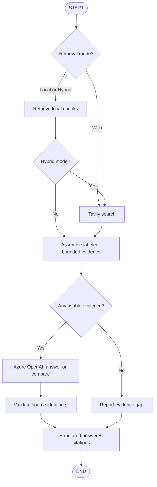
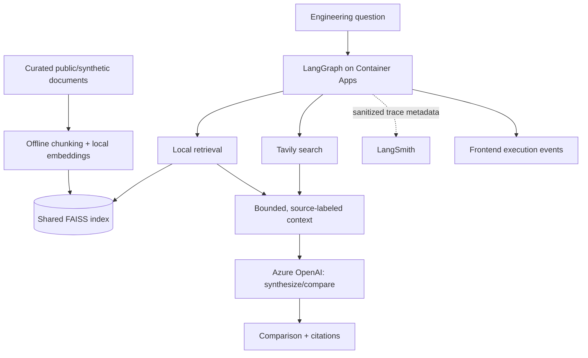

# Product Requirements Document (PRD)

## Engineering Knowledge Assistant

| Field | Value |
|---|---|
| Product / repository | `engineering-knowledge-assistant` |
| Status | Draft — v1.1 |
| Updated | 2026-11-04 |
| Product type | Public GitHub portfolio project and usable engineering assistant |
| Primary users | Software engineers, software architects, technical reviewers |
| Primary deployment | Azure Container Apps |
| Local deployment | Docker Compose |
| Primary use case | **Compare and synthesize engineering information from a curated document collection and current public web results** |

## 1. Product Vision and Executive Summary

**Engineering Knowledge Assistant** helps software engineers understand what their existing technical documents say, discover relevant current information from public web sources, and **compare or combine both bodies of evidence** to inform engineering decisions.

Its primary interaction is a **hybrid engineering question**, for example: *“How does the timeout strategy in our reference architecture compare with current embedded-system watchdog design recommendations?”* The assistant retrieves evidence from one **shared, predefined RAG knowledge base**, performs a **single targeted Tavily web search**, and uses **one Azure OpenAI generation call** to produce a source-grounded comparison. It explicitly distinguishes documented design choices, external findings, differences, and possible improvements.

The implementation is also an architecture showcase: **LangGraph** coordinates a bounded workflow; **LangChain** integrates retrieval and model calls; **LangSmith** records developer traces; the frontend exposes an understandable execution timeline; and the application supports **Docker** and **Azure Container Apps** deployments. The project's primary value to end users is *evidence-based comparison and synthesis*, not a generic chatbot or autonomous deep-research system.

## 2. User Problem and Value Proposition

Engineering teams frequently face two separate knowledge sources:

- **Existing engineering knowledge:** architecture decisions, specifications, design guidelines, and technical documentation describing what a system currently does or is intended to do.
- **External knowledge:** current vendor guidance, technology documentation, articles, and publicly available recommendations describing alternative or newer approaches.

Today, an engineer often searches these separately, reads multiple sources, reconciles terminology, and manually decides whether the current solution remains appropriate. A general-purpose chatbot does not automatically know the team's curated documentation or preserve a clear distinction between the two evidence sets.

**The application reduces the work required to locate, compare, and synthesize relevant evidence.** It should help users answer:

1. **What do our documents say?**
2. **What do relevant public sources say now?**
3. **Where do they agree, disagree, or leave open questions?**
4. **What engineering options or follow-up investigations are justified by the evidence?**

It is a decision-support tool, **not** a design authority. Recommendations must be presented as suggestions or tradeoffs, not as verified compliance statements. The user can inspect citations and the execution path.

## 3. Users, Modes, and Representative Scenarios

### 3.1 Intended users

- **Software engineer / architect:** Understands a documented solution, researches alternatives, and compares their implications.
- **Portfolio reviewer:** Evaluates the application's functionality, generated LangGraph diagram, RAG implementation, observability, tests, and cloud architecture.
- **Developer / operator:** Inspects LangSmith traces, errors, latency, token usage, call limits, and deployment behavior.

### 3.2 Retrieval modes

| Mode | Purpose | Evidence used | Expected result |
|---|---|---|---|
| **Hybrid (default)** | **Compare or combine engineering knowledge with current web findings** | Shared RAG corpus **and** Tavily | Structured comparison and synthesis, with citations from each available source type |
| Local | Understand documented designs or constraints | Shared RAG corpus only | Explanation grounded in local document excerpts |
| Web | Research public technical approaches | Tavily only | Current public-source summary, with links and retrieval date |

The UI explicitly allows mode selection. **Hybrid is the default and the principal demonstration scenario.** Local and Web modes support simpler research tasks and reveal the routing decisions in LangGraph.

### 3.3 Example questions

1. **Compare (primary):** “How does the sensor timeout handling described in our reference architecture compare with current watchdog recommendations for embedded systems?”
2. **Combine (primary):** “Our design uses a heartbeat monitor. What additional failure-detection considerations are suggested by recent public technical guidance?”
3. **Understand:** “What timeout thresholds and fallback states are specified in the sample architecture?”
4. **Research:** “What do current official sources say about watchdog strategies on embedded Linux?”
5. **Insufficient evidence:** “How does our architecture comply with a requirement that is absent from the corpus?” → Explicit evidence gap; no invented compliance assertion.
6. **Inspect trace:** The user expands the execution panel to see the chosen route, retrieved counts, external search, generation, timings, and sources.

The initial document corpus should tell a coherent, **synthetic engineering story** (e.g., a sensor-monitoring/watchdog system) so that the comparison is meaningful. Documents must be publicly redistributable or synthetic, with provenance and license notes.

## 4. Product Goals and Success Criteria

| ID | Goal | Evidence of success |
|---|---|---|
| G-01 | **Deliver useful engineering comparisons** | Hybrid answers separately identify internal evidence, external findings, agreements/differences, and supported implications |
| G-02 | Make claims auditable | Assertions reference actual retrieved document sections or external URLs; uncertain or missing evidence is clearly labeled |
| G-03 | Demonstrate LangGraph orchestration | Explicit `StateGraph`, state schema, conditional routing, deterministic limits, and a diagram generated from the compiled graph |
| G-04 | Demonstrate RAG and selective disclosure | Offline ingestion, chunking, local embeddings, one shared FAISS index, bounded retrieval, and tests of outgoing model payloads |
| G-05 | Demonstrate controlled web enrichment | Tavily integrated with at most one basic search in Web/Hybrid mode; zero in Local mode |
| G-06 | Make execution observable | End user sees a sanitized request timeline; developer can inspect correlated LangSmith traces |
| G-07 | Demonstrate cloud/software engineering | Reproducible Docker development, Azure Container Apps deployment, CI, tests, architecture decisions, and evaluation results |

**Version 1 success:** A reviewer can run the app, ask the primary comparison question, inspect an answer with differentiated sources, view the graph execution trace, and verify the architecture and behavior in documentation and automated tests.

## 5. Scope and Non-goals

### 5.1 In scope for v1

- A React/TypeScript single-page application and FastAPI backend.
- **Hybrid retrieval as the default**, plus Local and Web modes.
- A small **shared, read-only FAISS** index built offline from predefined public/synthetic engineering documents using local CPU embeddings.
- Targeted Tavily public web search and an Azure OpenAI model for synthesis.
- Source-grounded **comparison output**, with differences, agreements, caveats, and possible engineering next steps.
- A bounded LangGraph workflow with conditional edges and explicit fallback paths.
- LangSmith developer tracing, sanitized frontend execution timeline, and optional manually curated public example traces.
- Docker Compose, Azure Container Apps deployment instructions, GitHub Actions, and automated testing.
- Generated Mermaid LangGraph documentation and a separate knowledge/data-boundary diagram.

### 5.2 Out of scope for v1

- Deep-search agents, autonomous multi-agent research, recursive browsing, or unlimited tool/model retries.
- Per-user RAG databases, document upload, user accounts, document editing, or automatic corpus updates from the public UI.
- Conversation memory, long-running research jobs, or background agents.
- Multiple LLM providers, training, fine-tuning, or GPU inference.
- Azure AI Search or a managed vector database; production-scale horizontal vector search.
- Automated design approval, compliance certification, or guarantees that external web information is complete or correct.
- Automatic publication of arbitrary end-user LangSmith traces.

## 6. Functional Requirements

| ID | Priority | Requirement | Acceptance criterion |
|---|---|---|---|
| FR-01 | Must | Present `Hybrid`, `Local`, and `Web` modes; **Hybrid is the default**. | Default UI and API behavior use Hybrid unless a mode is explicitly selected. |
| FR-02 | Must | Accept an engineering question and return an answer based on selected evidence sources. | All three modes run end-to-end with documented sample questions. |
| FR-03 | Must | **Compare and synthesize** local and web evidence in Hybrid mode. | Result separates documented approach, web findings, agreements/differences, and supported implications. |
| FR-04 | Must | Clearly distinguish factual evidence from analysis and suggestions. | Any recommendation is marked as an interpretation/proposal and supported by cited evidence or an explicit caveat. |
| FR-05 | Must | Cite the underlying information. | Document claims link to document ID/section/page; external claims link to actual Tavily-returned URLs. No invented references. |
| FR-06 | Must | Handle unavailable evidence from either source independently. | If one side is missing, the answer states the comparison is incomplete and reports the available side without inventing the other; if both are missing, return an evidence-gap response. |
| FR-07 | Must | Use LangGraph `StateGraph` with explicit state, nodes, and conditional edges. | Compiled graph matches expected paths in tests and generated Mermaid documentation. |
| FR-08 | Must | Use a **single shared, predefined RAG index** for all users. | Concurrent requests access the same read-only corpus; each request has independent graph state/trace. |
| FR-09 | Must | Provide reproducible offline document ingestion. | Script builds index and source metadata from versioned sample documents; query embedding uses the same model. |
| FR-10 | Must | Retrieve relevant document excerpts locally. | Configurable default `top_k=4`, ranking/threshold behavior, source metadata, and context size budget. |
| FR-11 | Must | Integrate Tavily basic search. | **At most one** Tavily request and **at most three results** in each Web/Hybrid question; none in Local. |
| FR-12 | Must | Keep retrieved document chunks out of Tavily requests. | Automated test captures Tavily payload and verifies document excerpts are absent. |
| FR-13 | Must | Use one Azure OpenAI final answer-generation call at most. | Mock-based test verifies one call or zero on insufficient evidence; no implicit LLM grading or rewrite loops. |
| FR-14 | Must | Limit prompt context and generated output. | Configurable chunk and token budgets are applied; timeouts and failures terminate requests predictably. |
| FR-15 | Must | Identify the retrieval time of web evidence. | Web answers display a retrieval timestamp; publishing date is displayed only if supplied by the source. |
| FR-16 | Must | Provide source-separated answers for Hybrid mode. | UI renders distinct document/web source lists and a structured comparison section. |
| FR-17 | Must | Show a sanitized execution timeline to the user. | Visible node order, branch, statuses, durations, source counts, and call counts, without backend credentials. |
| FR-18 | Must | Integrate LangSmith for developer tracing. | Configured requests produce correlated traces; tracing may be disabled without preventing normal answers. |
| FR-19 | Must | Generate the Mermaid LangGraph diagram from actual code. | Documented export command writes `docs/langgraph.md`; CI detects a stale graph diagram. |
| FR-20 | Must | Run locally and deploy to Azure Container Apps. | Docker Compose setup works; documented Container Apps deploy and smoke test are provided. |
| FR-21 | Should | Display token usage and estimated cost. | Values use provider usage data when available, with clear estimated/unavailable labels. |
| FR-22 | Should | Expose only curated example LangSmith trace links. | Public trace links, if any, are manually reviewed for safe synthetic/public content. |
| FR-23 | Should | Provide a small evaluation corpus and report. | Includes comparison correctness, source coverage, missing-evidence handling, retrieval relevance, latency, and budget adherence. |

## 7. LangGraph Orchestration

### 7.1 Required conceptual workflow

The graph controls **retrieval and routing**. It does **not** independently call one model to summarize local results, another to summarize web results, and a third to compare them. Instead, the final generation step receives the **bounded, labeled evidence from both sources** and performs comparison/synthesis in a single call.



This diagram is a **design illustration**. The authoritative documentation diagram in `docs/langgraph.md` must be **generated from the compiled LangGraph graph**, not maintained by hand.

### 7.2 Graph state and routing

Suggested graph state fields:

- `request_id`, `question`, `retrieval_mode`
- `local_sources`, `web_sources`, `selected_context`
- `local_evidence_status`, `web_evidence_status`, `overall_evidence_status`
- `answer`, `citations`, `comparison_status`
- `execution_events`, `usage_metrics`, `error`

**Routing rules:** Local invokes only RAG; Web invokes only Tavily; Hybrid invokes both (sequentially is acceptable for v1). Missing source evidence must be represented in state and in the response. A deterministic evidence gate may use score/threshold heuristics but must not claim those heuristics guarantee factual sufficiency.

### 7.3 Hard execution budgets

| Operation | Maximum per question |
|---|---:|
| Tavily basic search | **1** (0 in Local mode) |
| Azure OpenAI answer generation | **1** |
| Selected local chunks | Default **4**, configurable |
| Tavily results | Default **3**, configurable below/equal to enforced cap |
| Automatic research / query-rewrite loops | **0** |

Rate limits, token budgets, request deadlines, and bounded failure handling must also be enforced. No hidden automatic model retries that would violate the call budget.

## 8. Shared RAG Knowledge Base

### 8.1 Document corpus

The initial corpus consists of **fixed, public or synthetic engineering documents**, preferably focused on one coherent design scenario. Example files: reference architecture, design decisions, watchdog/heartbeat specification, and test strategy in Markdown, AsciiDoc, or PDF.

Users cannot upload their own documents in v1. All users query **the same versioned knowledge collection**, not a personal database.

### 8.2 Ingestion and retrieval

1. Offline loader parses the predefined files and retains title, document ID, section/page, version, and provenance metadata.
2. A configurable chunker creates appropriately sized passages with sensible overlap.
3. A **local CPU embedding model** generates vector representations.
4. The vectors and metadata are indexed in **FAISS**.
5. Each question is embedded locally; only the relevant top-ranked excerpts within the context budget are selected.

Document embedding/index creation happens **outside** the request path. For the small sample corpus, the prepared FAISS index can be packaged as a **versioned, read-only artifact in the backend container image**. This avoids a managed vector store and, initially, a separate persistent volume. The FAISS index is loaded once per process; request state remains independent.

### 8.3 RAG disclosure boundary

The entire corpus is not transmitted to Azure OpenAI. **Selected retrieved excerpts are transmitted** when used as prompt context. This is context minimization, **not** a claim of complete confidentiality. For the public demo, all corpus files are non-sensitive by design.

## 9. Tavily and Current Web Evidence

- Use Tavily for **targeted public technical searches**, not broad autonomous deep research.
- In Hybrid mode, run at most one `basic` search to obtain complementary external evidence relevant to the engineering question.
- Use a small result count (default three); exclude optional raw page bodies and generated Tavily answers unless explicitly justified in a future design decision.
- Do not add RAG document excerpts to Tavily requests. The user's question or derived public-topic query may be sent externally; this must be documented.
- Persist the returned title, URL, snippet and retrieval timestamp in request state, without treating webpage text as trusted instructions.
- A retrieval timestamp is **not a guarantee** that web content is freshly published, authoritative, or complete. Prefer official technical documentation and show source dates when available.
- If Tavily fails or returns no relevant results, label web evidence unavailable and produce an appropriately limited answer using the remaining evidence, rather than fabricating a comparison.

## 10. Answer and Comparison Contract

**Hybrid mode** should return a predictable structure that helps the engineer make sense of both sources:

1. **Documented approach:** What the curated engineering documentation actually says, with document references.
2. **Current web findings:** What relevant public sources report, with URLs and an as-of/retrieval date.
3. **Comparison:** Explicit agreements, differences, tradeoffs, and important gaps; do not force a difference where none is supported.
4. **Engineering implications:** Optional improvements, decisions to investigate, and uncertainties, explicitly distinguished from verified source facts.
5. **Sources:** Human-readable source list with source type, reference/link, and relevant metadata.

In Local or Web mode, omit comparison-only sections that cannot be supported. If Hybrid retrieves evidence from just one side, show a **partial result** and prominently state why a two-source comparison was not possible. If neither source provides usable evidence, return an **insufficient-evidence response** without invoking the LLM if feasible.

**Quality constraints:** The LLM must not invent document sections, URLs, standards claims, dates, or compliance conclusions. Citation identifiers in the generated output must be checked against retrieved source IDs. This validation detects unknown references but **does not itself prove that a claim is supported**; evaluation must test grounding separately.

## 11. Frontend User Experience

Use **React + TypeScript** as a separate SPA communicating with **FastAPI** via REST and Server-Sent Events (SSE).

### 11.1 Required UI

- Question input with optional predefined example questions.
- Mode selector: **Hybrid (default)**, Local, Web.
- Structured result panel with clear headings and differentiated **Document** / **Web** citations.
- In Hybrid mode, visible **Comparison / Engineering implications** sections; missing-evidence warnings when applicable.
- Expandable **Execution Trace**: nodes, branch choices, statuses, elapsed times, local chunk count, Tavily result count, and total LLM/Tavily call counts.
- Request summary: duration, input/output tokens if provided, estimated LLM cost if configured, source counts, and request ID.
- Links to the repository's architecture, LangGraph diagram, and RAG data-flow documentation.

### 11.2 Illustrative user interaction

**Question:** “How does our sensor monitoring design compare with current public watchdog recommendations?”

**Displayed response:** “Documented approach” → “Web findings” → “Agreements and differences” → “Potential improvements / unresolved questions” → “Sources.” The UI can show a completed trace such as *Local retrieval → Tavily → Context assembly → LLM synthesis → Source validation*.

No numerical performance or evidence findings should be hard-coded into production responses; all displayed counts/timings must reflect actual execution.

## 12. Architecture, Deployment, and Cost Control

| Layer | Choice | Responsibility |
|---|---|---|
| Frontend | React, TypeScript | Questions, results, citations, trace timeline |
| API | FastAPI, Python | Request validation, rate limiting, REST/SSE |
| Orchestration | LangGraph | Explicit bounded graph and state |
| RAG | LangChain, FAISS | Local retrieval over shared corpus |
| Embeddings | Local CPU model | Ingestion and query vectors |
| External evidence | Tavily | One targeted basic web search |
| Generation | Azure OpenAI | One answer or comparison synthesis |
| Observability | LangSmith | Detailed developer tracing |
| Tooling | `uv`, Docker | Reproducible builds and local setup |
| Cloud | Azure Container Apps | Container deployment (frontend + backend) |
| CI | GitHub Actions | Linting, tests, build, documentation checks |

### 12.1 Logical data flow



**Interpretation:** The diagram presents the Hybrid request path; conditional routing skips local retrieval and/or Tavily in the other modes. Ingestion occurs separately from serving. LangSmith traces are emitted by instrumented graph/tool/model operations (not necessarily only the top-level graph node).

### 12.2 Deployment requirements

- Use Docker Compose for local development and **Azure Container Apps** for cloud hosting of the two containers (frontend + backend). Put Docker-related artifacts under `docker/` where practical.
- Keep the demonstrator small: one revision/replica per component, CPU-only, modest resource allocations.
- Packaged FAISS artifacts are appropriate for the small fixed corpus; scaling beyond a single service replica may duplicate memory/index state and is not a v1 goal.
- Configure API keys and model endpoints at runtime via secrets/environment configuration, never in the repository or browser.
- Protect a public demo with request size limits, rate limits, timeouts, and configurable per-request token/search budgets.
- Provide Azure budget/alert setup, deployment, smoke-test, and teardown instructions. Prefer Container Apps over Kubernetes for this portfolio demonstrator so infrastructure cost stays near the application cost.
- A continuously running public demo is optional. A reproducible local demonstration and a Container Apps deployment that can be activated when needed are acceptable.
- **Helm / AKS are out of scope for v1** — unnecessary packaging for a two-container demonstrator.

## 13. LangSmith and User-Visible Observability

**LangSmith** is for deep developer diagnostics; the application frontend should offer a **sanitized execution timeline** without requiring the viewer to log in to LangSmith.

- Correlate the backend request ID with the LangSmith trace/run identifier when tracing is active.
- Record node outcomes, selected source counts, tool invocation counts, durations, model token usage when available, and errors.
- Stream sanitized, non-sensitive execution events via SSE (or fetch them after completion if simpler for the first milestone).
- Optionally publish **manually reviewed demonstration traces**, using only public/synthetic content. Do not automatically publish arbitrary user-run traces.
- Do not expose LangSmith API keys, internal credentials, or privileged trace-query endpoints to the browser.
- Even with non-sensitive sample documents, document the tracing boundary: prompts, chunks, user questions, and tool responses **may be exported to LangSmith unless configured otherwise**.

## 14. Testing, Evaluation, and Acceptance

### 14.1 Automated tests

| ID | Assertion |
|---|---|
| T-01 | Hybrid is the default retrieval mode in UI and API. |
| T-02 | Local mode never calls Tavily. |
| T-03 | Web mode never queries FAISS. |
| T-04 | Hybrid mode invokes both RAG and Tavily, with no more than one Tavily request. |
| T-05 | All requests use the same shared index; graph state is isolated per request. |
| T-06 | Only selected local chunks (not the full corpus) are present in the Azure OpenAI generation request. |
| T-07 | Tavily payloads never contain retrieved document excerpts. |
| T-08 | The LLM generation call count is at most one per question. |
| T-09 | Top-K selection and prompt/token limits are enforced. |
| T-10 | Hybrid output contains source-separated evidence and a comparison when both sides are available. |
| T-11 | If one source is unavailable, the response identifies the limitation instead of fabricating findings. |
| T-12 | If neither source provides evidence, the graph terminates with an explicit evidence gap. |
| T-13 | All generated citation IDs map to actual retrieved document sections or web URLs. |
| T-14 | Trace events match executed graph nodes and modes; secrets are not sent to the frontend. |
| T-15 | External errors/timeouts terminate without uncontrolled retries. |
| T-16 | Generated Mermaid diagram matches the compiled LangGraph workflow. |

Use mocked Tavily/Azure clients for deterministic CI. Run optional, clearly marked live smoke tests only with configured credentials.

### 14.2 Quality evaluation

Ship a small versioned evaluation dataset containing **supported comparisons**, **contradictory findings**, **single-source evidence gaps**, **unsupported questions**, and **Local/Web-only questions**. Report measured results rather than inventing a benchmark score.

Evaluation dimensions:

- Retrieval relevance: Did the retriever select the expected document sections?
- Web relevance: Did the search results provide useful external evidence?
- **Comparison quality:** Did the answer accurately identify agreement, disagreement, and limitations across the two evidence sets?
- Grounding and citation correctness: Are claims supported by cited material and do references exist?
- Resilience: Are incomplete sources and timeouts communicated honestly?
- Predictability: Latency, token counts, one-call limits, and estimated execution cost.

**Release acceptance:** All `Must` requirements and tests pass; the primary Hybrid question produces a documented, source-separated comparison; the UI shows an actual trace; and the README provides reproducible setup, diagrams, limitations, evaluation findings, and Container Apps instructions.

## 15. Suggested Repository Layout

```text
engineering-knowledge-assistant/
├── README.md
├── PRD.md
├── docs/
│   ├── product-overview.md
│   ├── architecture.md
│   ├── langgraph.md            # generated from compiled graph
│   ├── rag-data-flow.md
│   ├── deployment-container-apps.md
│   ├── evaluation.md
│   └── decisions/
├── sample_documents/           # public/synthetic engineering corpus
├── scripts/
│   ├── ingest.py
│   └── export_graph.py
├── backend/
│   ├── src/
│   │   ├── api/
│   │   ├── graph/
│   │   ├── retrieval/
│   │   ├── integrations/
│   │   └── observability/
│   └── tests/
├── frontend/
├── evaluations/
├── docker/
│   ├── compose.yaml
│   └── ...
├── .github/
│   └── workflows/
└── pyproject.toml
```

Directory details may evolve during implementation; keep ingestion, orchestration, source integration, UI, and infrastructure clearly separated.

## 16. Milestones and Definition of Done

| Milestone | Deliverables | Done when... |
|---|---|---|
| **M1 — Shared RAG corpus** | Synthetic engineering docs, ingestion, embeddings, FAISS, source metadata, retrieval tests | Local queries retrieve relevant, citable excerpts from one shared index. |
| **M2 — Bounded LangGraph** | Graph, conditional routing, Azure OpenAI, evidence gating, generated Mermaid, call-budget tests | Local mode works end-to-end; one-call bounds and missing-evidence paths are tested. |
| **M3 — Hybrid comparison** | Tavily integration, Hybrid default, comparison prompt/output contract, evaluation cases | Primary user question combines both sources and differentiates agreements, differences, and uncertain claims. |
| **M4 — Traceable cloud demo** | React UI, LangSmith, frontend timeline, Docker Compose, Azure Container Apps, CI, README | Reviewers can reproduce the demo, inspect measured execution behavior and deploy with documented cost limits. |

**M3 is the product-value milestone**; M4 completes the cloud and observability showcase. Avoid adding multi-agent complexity before the hybrid comparison works reliably.

## 17. Risks and Mitigations

| Risk | Mitigation |
|---|---|
| Comparison looks authoritative despite incomplete sources | Make evidence coverage explicit; separate documented facts, public findings, and proposed implications. |
| Web result is outdated, low quality, or conflicts with other evidence | Show URLs and retrieval date; prioritize relevant authoritative sources; expose disagreements rather than silently reconciling them. |
| RAG misses a relevant document section | Maintain a measured evaluation set; tune chunking and retrieval thresholds. |
| LLM invents sources or overstates conclusions | Supply source IDs, validate references, test grounding, and state evaluation limitations. |
| Cost rises due to unexpected tool retries or public traffic | One Tavily/LLM call budgets, rate limits, token budgets, timeouts and Azure budgets. |
| Cloud idle cost exceeds application usage cost | Prefer Container Apps over Kubernetes; modest CPU allocations; stop/teardown instructions; local demo fallback. |
| Tavily or LangSmith receives text not intended for that provider | Never send retrieved chunks to Tavily; document question/trace disclosure and configure tracing deliberately. |
| Mermaid diagram drifts from implementation | Generate the diagram from the compiled graph and verify in CI. |

## 18. Potential Later Enhancements (Not v1 Commitments)

- A second LLM provider with explicit deterministic routing to demonstrate multi-model orchestration.
- Per-session LangGraph checkpointing and conversational follow-up questions, still sharing the same corpus.
- A reranking stage or additional non-LLM evidence-quality checks.
- A richer execution view highlighting graph nodes as they run.
- Domain-specific comparison templates for architecture alternatives or engineering tradeoffs.
- Corpus updates through a controlled ingestion pipeline (not uncontrolled user uploads).

## 19. Architectural Principles

1. **User problem first:** Compare and synthesize existing engineering knowledge with current public information.
2. **Evidence before recommendation:** No unsupported comparison, missing citation, or invented compliance statement.
3. **One knowledge base, independent executions:** All users share the same versioned corpus; graph state and traces belong to individual requests.
4. **Bound every paid operation:** A small explicit LangGraph is preferable to costly autonomous deep research for this use case.
5. **Control data boundaries:** RAG limits document context; web search and tracing are separate external disclosure paths.
6. **Show the architecture:** Generated LangGraph diagram, RAG data-flow, trace timeline, evaluation results, and automated tests.
7. **Keep it reproducible:** Docker-first local development, public/synthetic sample content, and a cost-conscious Azure Container Apps deployment.
