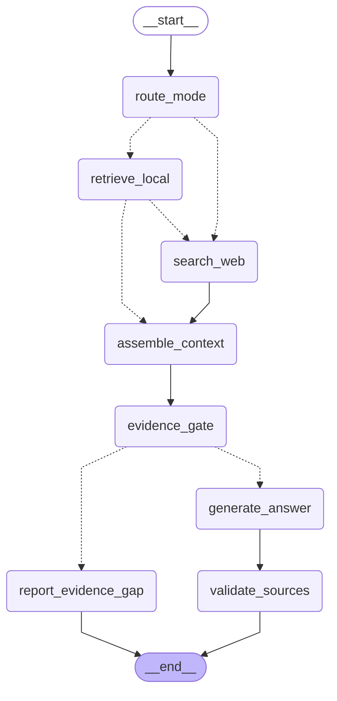

# LangGraph Workflow

This diagram is **generated from the compiled LangGraph graph**.
Do not edit the Mermaid block by hand — run `uv run python scripts/export_graph.py`.

## Retrieval and synthesis flow

