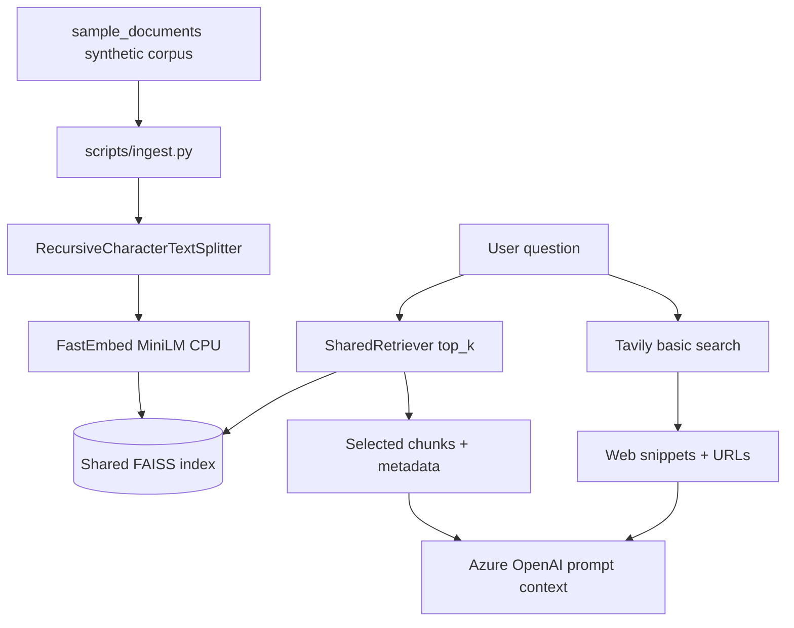

# RAG data flow and disclosure boundaries

## Ingestion

- Offline only, during the backend image build (`scripts/ingest.py` via container `uv`)
- Parses YAML frontmatter (`doc_id`, title, version, section)
- Chunk size 800 / overlap 120 (configurable)
- Index packaged into the backend container image

## Query-time retrieval

- Default `top_k=4`, score threshold `0.25`, context budget `6000` chars
- Oversized first hit is truncated to remaining budget

## Disclosure

| Destination | What is sent |
|---|---|
| Azure OpenAI | Question + selected labeled excerpts + web snippets |
| Tavily | Question string only |
| LangSmith | Possibly prompts/tools/chunks when tracing is on |
| Browser | Sanitized answer, citations, execution events |
